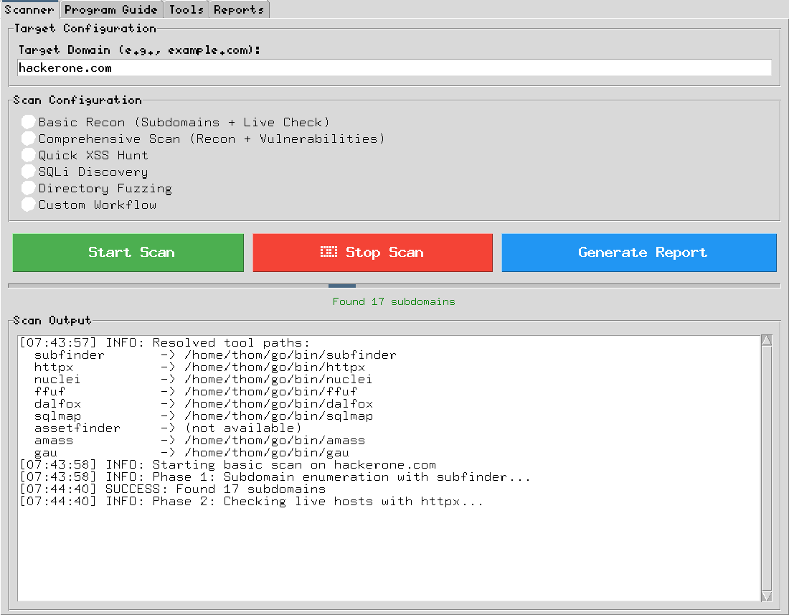

# BugBountyHunter Pro v2.0
## Beginner's Complete Bug Bounty Hunting Toolkit

A GUI tool that walks a beginner through the whole bug bounty loop: pick a
program, run recon, find something worth reporting, write it up. It wraps
`subfinder`, `httpx`, `nuclei`, `ffuf` and `dalfox` behind one window, keeps a
local SQLite history of every scan, and generates submission-ready markdown
reports.




> **New here?** Read [Authorised Use Only](#-authorised-use-only) before your
> first scan. This tool sends real traffic to real hosts.

## 🎯 Features

### 🖥️ Modern GUI Interface
- **4 Main Tabs**: Scanner, Program Guide, Tools, Reports
- **Real-time Progress Tracking**: Live scan progress and status updates
- **Professional UI**: Clean, intuitive interface designed for beginners

### 🔍 Automated Scanning Capabilities
- **Basic Reconnaissance**: Subdomain enumeration + live host discovery
- **Comprehensive Scanning**: Full recon + vulnerability assessment
- **Specialized Scans**: XSS hunting, directory fuzzing, SQLi discovery
- **Multi-threading**: Efficient concurrent scanning
- **Fail-loud preflight**: a scan whose tools cannot run is refused *before* it
  starts, never recorded as a clean result

### 📊 Professional Reporting
- **Markdown Reports**: Professional vulnerability documentation
- **Multiple Templates**: Executive, technical, and detailed findings
- **Automated Evidence**: Screenshot integration and proof collection
- **Industry Standards**: Reports formatted for bug bounty submissions

### 🎓 Beginner Guidance
- **Platform Recommendations**: Curated list of beginner-friendly programs
- **Tool Installation**: Step-by-step setup guides
- **Best Practices**: Integrated tips and methodologies
- **Realistic Expectations**: Honest earning projections and timelines

### 💾 Data Management
- **SQLite Database**: Persistent scan result storage
- **Scan History**: Track all previous assessments
- **Result Correlation**: Link subdomains, vulnerabilities, and evidence
- **Export Capabilities**: Multiple output formats

## 🚀 Quick Start

### One-click install (Linux / macOS)

```bash
curl -fsSL https://raw.githubusercontent.com/bongthrottla/bugbountyhunter/main/install.sh | bash
```

That clones the repo to `~/bugbountyhunter`, checks Python and tkinter, downloads
the reconnaissance tools as prebuilt binaries into `~/.local/bin`, adds that to
your `PATH`, and verifies everything. **No Go toolchain needed.** Re-running it
updates an existing install in place.

Then:

```bash
cd ~/bugbountyhunter && python3 BugBountyHunter.py
```

### Manual install

Only **Python 3.7+ with tkinter** is required. Everything else is optional.

1. **Clone the repository**
   ```bash
   git clone https://github.com/bongthrottla/bugbountyhunter.git
   cd bugbountyhunter
   ```

2. **Install the reconnaissance tools**
   ```bash
   ./scripts/install-tools.sh
   ```
   Downloads prebuilt release binaries for subfinder, httpx, nuclei, ffuf, gau
   and dalfox into `~/.local/bin`. It prints the `PATH` line to add.

   On Windows, use `install.ps1` (PowerShell) instead.

3. **Run the Application**
   ```bash
   python3 BugBountyHunter.py
   ```

   Or install it as a package and launch it from anywhere:
   ```bash
   pip install .
   bugbountyhunter
   ```

   `requirements.txt` lists only optional third-party packages — the GUI,
   database and process handling are all Python standard library, so there is
   nothing mandatory to `pip install`.

### If a tool is missing

The app still starts and tells you exactly which tools are unavailable, and a
scan whose tools cannot run is refused before it begins rather than reported as
a clean result. Re-run `scripts/install-tools.sh` when you have network access.

`assetfinder` is the one tool with no prebuilt binaries — it is built from
source only if Go is present, and skipped otherwise. Nothing depends on it.

### Verify your install

```bash
pip install pytest
pytest test_BugBountyHunter.py -v      # 16 tests, ~3min
```

The suite covers target validation, tool requirements, directory/database
setup, and the URL-to-hostname matching that drives live-host reporting. On a
headless box run it under `xvfb-run -a pytest ...` — the app needs a display.

### A real run

Pointing the Basic Recon scan at `hackerone.com` (a public program; recon only)
produces this in the log pane:

```
[07:41:29] INFO: Starting basic scan on hackerone.com
[07:41:30] INFO: Phase 1: Subdomain enumeration with subfinder...
[07:42:00] SUCCESS: Found 17 subdomains
[07:42:00] INFO: Phase 2: Checking live hosts with httpx...
[07:42:07] SUCCESS: Found 6 live hosts
[07:42:07] SUCCESS: Scan completed! Results saved to scans/scan_1_hackerone.com
```

and a report in `reports/` that opens with:

```
### Subdomain Discovery
- **Total Subdomains Found:** 17
- **Live Hosts:** 6
- **Success Rate:** 35.3%
```

Every scan is recorded in `scans/bugbounty.db` with its status, so you can come
back to it from the Reports tab later.

### Essential Tools Installation (manual)

```bash
# Core reconnaissance tools
go install -v github.com/projectdiscovery/subfinder/v2/cmd/subfinder@latest
go install -v github.com/projectdiscovery/httpx/cmd/httpx@latest
go install -v github.com/projectdiscovery/nuclei/v3/cmd/nuclei@latest

# Additional scanning tools
go install github.com/ffuf/ffuf@latest
go install github.com/hahwul/dalfox/v2@latest
go install github.com/lc/gau@latest
go install github.com/tomnomnom/assetfinder@latest

# Update nuclei templates
nuclei -update-templates

# Make the tools reachable
export PATH="$PATH:$HOME/go/bin"
```

The app also detects `~/go/bin` automatically when launched from a desktop
environment that does not inherit your interactive `PATH`.

## 📖 Usage Guide

### Your First Scan
1. **Launch** the application: `python3 BugBountyHunter.py`
2. **Enter Target**: Input domain (e.g., `example.com`)
3. **Select Scan Type**: Choose "Basic Recon" for beginners
4. **Start Scan**: Click "Start Scan"
5. **Review Results**: Check the output area for findings
6. **Generate Report**: Click "Generate Report"

> Only scan systems you are authorised to test. See the note at the bottom of
> this README.

### Scan Types Explained

| Scan Type | Description | Tools Used | Best For |
|-----------|-------------|------------|----------|
| **Basic Recon** | Subdomain enumeration + live host discovery | subfinder, httpx | Beginners, asset discovery |
| **Comprehensive** | Full recon + vulnerability scanning | subfinder, httpx, nuclei | Complete assessment |
| **XSS Hunt** | Cross-site scripting focused | dalfox, httpx | XSS specialists |
| **Directory Fuzz** | Hidden file/directory discovery | ffuf, httpx | Content discovery |
| **SQLi Discovery** | SQL injection detection prep | Manual guidance | Database testing |

### Program Recommendations
The application includes curated recommendations for:

#### 🏆 Top Beginner Platforms
1. **HackerOne** - Largest platform, excellent training
2. **Bugcrowd** - Good beginner support  
3. **Intigriti** - European focus, personal touch
4. **Open Bug Bounty** - Free practice platform

#### 🎯 Easiest Bug Types for Beginners
1. **Cross-Site Scripting (XSS)** - Most common, easiest to verify
2. **Information Disclosure** - Exposed files and debug info
3. **Missing Security Headers** - Quick automated findings
4. **Open Redirects** - Common in authentication flows

## 🛠️ Tool Integration

The application seamlessly integrates with industry-standard tools:

### Reconnaissance Tools
- **Subfinder**: Fast subdomain enumeration with multiple sources
- **httpx**: HTTP service discovery and technology detection
- **Amass**: Advanced subdomain enumeration with DNS techniques
- **Assetfinder**: Related domain and asset discovery

### Vulnerability Scanners  
- **Nuclei**: Template-based vulnerability scanner (4000+ templates)
- **Dalfox**: Advanced XSS parameter analysis and fuzzing
- **ffuf**: High-performance web fuzzer for directory discovery

### Manual Testing Integration
- **Burp Suite Community**: Professional web application testing
- **OWASP ZAP**: Free security testing proxy
- **Browser DevTools**: Built-in analysis capabilities

## 📊 Reporting Features

### Report Types
- **Executive Summary**: High-level findings for management
- **Technical Details**: In-depth vulnerability analysis  
- **Recon Summary**: Asset discovery and enumeration results
- **Custom Reports**: Tailored for specific requirements

### Report Contents
- Target information and scope
- Methodology and tools used
- Detailed findings with evidence
- Risk assessments and impact analysis
- Remediation recommendations
- Professional formatting for submissions

## 🎓 Learning Resources

### Integrated Guidance
- **Step-by-step tutorials** within the application
- **Best practices** embedded in each workflow
- **Common mistakes** and how to avoid them
- **Realistic expectations** for beginners

### External Resources
- **HackerOne Hacker101**: Free training courses
- **PortSwigger Web Security Academy**: Hands-on labs
- **OWASP Testing Guide**: Comprehensive methodology
- **Bug bounty writeups**: Real-world examples

## 📁 File Structure

```
BugBountyHunter/
├── BugBountyHunter.py      # Main application
├── requirements.txt        # Python dependencies  
├── README.md              # This file
├── scans/                 # Scan results and database
│   └── bugbounty.db      # SQLite database
├── reports/               # Generated reports
├── wordlists/            # Fuzzing wordlists
├── outputs/              # Raw tool outputs
└── configs/              # Configuration files
```

## 🔧 Configuration

### Database
- **Type**: SQLite (no setup required)
- **Location**: `scans/bugbounty.db`
- **Tables**: scans, subdomains, vulnerabilities
- **Backup**: Copy the entire `scans/` directory

### Output Directories
- **scans/**: Individual scan results and database
- **reports/**: Professional markdown reports
- **wordlists/**: Custom fuzzing wordlists
- **outputs/**: Raw tool outputs for analysis

### Tool Configuration
Most tools work with default settings, but you can customize:
- **Nuclei templates**: Update with `nuclei -update-templates`
- **Wordlists**: Add custom lists to `wordlists/` directory  
- **API keys**: Configure in respective tool config files

## ⚠️ Legal and Ethical Guidelines

### 🛡️ CRITICAL: Always Stay Legal
- **Only test targets with explicit permission**
- **Respect bug bounty program scopes and rules**
- **Never test production systems without authorization**
- **Don't access other users' data or systems**

### Best Practices
1. **Read program policies** carefully before testing
2. **Ask questions** if scope is unclear
3. **Report vulnerabilities promptly** and professionally  
4. **Don't publicly disclose** until fixed
5. **Respect rate limits** and don't overload systems

### Recommended Practice Targets
- **Intentionally vulnerable applications**: DVWA, WebGoat
- **Personal lab environments**: Local virtual machines
- **Authorized bug bounty programs**: Only with explicit permission

## 🐛 Troubleshooting

### Common Issues

#### Tool Installation Problems
```bash
# If "command not found" after installation
export PATH=$PATH:~/go/bin
# Add to ~/.bashrc or ~/.zshrc for persistence

# If Go installation issues
go version  # Verify Go is installed
which go   # Check Go location
```

#### GUI Issues
```bash
# Linux: Install tkinter if missing
sudo apt-get install python3-tk

# macOS: Tkinter usually included with Python
# Windows: Tkinter included with standard Python installation
```

#### Permission Errors
```bash
# Linux/macOS: Ensure proper permissions
chmod +x BugBountyHunter.py

# Windows: Run PowerShell as Administrator if needed
```

### Getting Help
1. **Check tool status** in the Tools tab
2. **Review error messages** in the scan output
3. **Verify tool installation** with `tool --version`
4. **Check file permissions** in output directories

## 🤝 Contributing

This project welcomes contributions! Areas for improvement:

### Code Contributions
- **Additional tool integrations** (gobuster, waybackurls, etc.)
- **Enhanced report templates** with more formats
- **Better error handling** and user feedback
- **Performance optimizations** for large scans

### Documentation
- **Video tutorials** for common workflows  
- **Additional practice scenarios** and examples
- **Tool-specific configuration guides**
- **Advanced usage patterns**

### Community
- **Share successful methodologies** and techniques
- **Report bugs** and suggest improvements
- **Help other beginners** with questions and guidance

## 📜 License

This project is licensed under the MIT License - see the LICENSE file for details.

## 🙏 Acknowledgments

### Inspiration and Tools
- **ProjectDiscovery**: For excellent open-source security tools
- **OWASP**: For web security guidelines and resources
- **Bug bounty community**: For sharing knowledge and methodologies
- **reNgine, BBOT, Ars0n Framework**: For architecture inspiration

### Educational Resources
- **NahamSec, STÖK, InsiderPHD**: For educational content
- **HackerOne, Bugcrowd**: For platform documentation
- **Security researchers**: For public writeups and sharing

## 📞 Support

For questions, suggestions, or issues:
1. **Check the troubleshooting section** first
2. **Review the integrated help** in the application
3. **Consult external resources** linked in the guides
4. **Practice on safe, authorized targets** before live testing

---

## ⚠️ Authorised Use Only

This tool performs active reconnaissance and vulnerability scanning against
whatever host you point it at. That is intrusive by design.

- **Only scan systems you own, or that are explicitly listed as in scope** in a
  bug bounty program's published policy.
- **Read the program scope before you scan.** Out-of-scope assets, excluded
  vulnerability classes, and required hunter identifiers (custom headers,
  account registration) are part of the rules, not obstacles.
- **Send any required hunter header** on every request where the program
  mandates one, and use only accounts you own.
- **Rate-limit yourself.** Respect `robots.txt` where the program asks for it,
  and back off on errors rather than hammering a target.
- **A failed scan is not a clean result.** If a tool errors (bad API key, rate
  limit, no network), the app reports the failure — do not read an empty output
  as "no attack surface."
- Unauthorised scanning may be an offence under laws including Australia's
  *Criminal Code Act 1995* (Cth) Part 10.7, the US CFAA, and the UK Computer
  Misuse Act. Ignorance of scope is not a defence.

---

**Remember**: Bug bounty hunting is a skill that develops over time. Be patient, stay curious, and always prioritize learning over earning. This tool is designed to accelerate your journey, but success comes from understanding the vulnerabilities, not just running scans.

**Happy hunting! 🚀**
